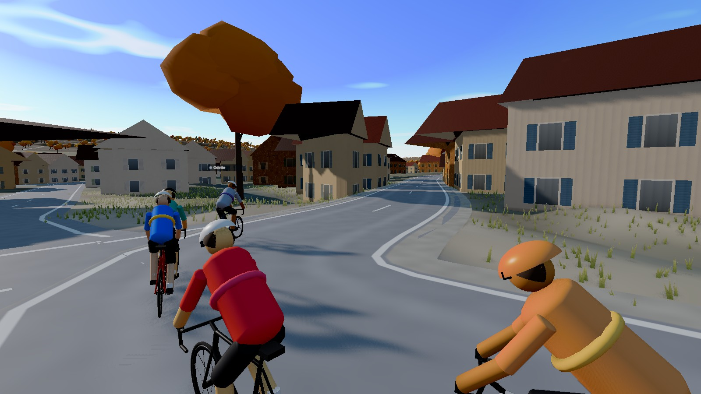

# Allez Robert !

> Simulateur de vélo d'intérieur gratuit, privé et multijoueur, pour rouler entre amis du plateau de Saclay à la forêt de Rambouillet par la vallée de Chevreuse.
> Clin d'œil à Robert Marchand, recordman de l'heure à 105 ans au vélodrome de Saint-Quentin-en-Yvelines.



## Ce qui marche aujourd'hui

- **Monde réel** : relief IGN LiDAR HD / RGE ALTI, routes, bâtiments, forêts et eau OpenStreetMap, orthophotos IGN ; boucle de 10 km par la Côte des 17 Tournants, plus trois grandes boucles (Chevreuse, Rambouillet, Saclay).
- **Matériel** : home trainers FTMS et FE-C (KICKR CORE / CORE 2…), pédales Assioma (CPS, balance G/D), cardio TICKR, Wahoo Direct Connect et ANT+ dans l'app Windows ; vitesses virtuelles (24 rapports), power match, simulateur de capteurs pour rouler sans matériel.
- **Jeu** : physique de Martin et al. (1998), aspiration, coureurs IA, segments KOM / sprint, fantôme de son record, séances ERG (.zwo / .erg / .mrc), test FTP, progression et garage.
- **Rendu** : Three.js WebGPU (repli WebGL2), saisons, jour / nuit, pluie, brouillard, végétation animée par le vent, préréglages bas → ultra.
- **Export** : fichier FIT conforme (balance G/D, positions GPS), validé par le SDK officiel Garmin.

## Démarrer

Prérequis : Node.js ≥ 22, pnpm 10 ; pour l'app Windows : Rust + outils MSVC + WebView2 (voir [apps/desktop/README.md](apps/desktop/README.md)).

```bash
pnpm install
pnpm --filter @allezrobert/terrain build:world   # génère les tuiles du monde (≈ 150 Mo, 3–4 min)
pnpm dev                                          # client sur http://localhost:5173
```

Sans tuiles générées, le client bascule sur un monde procédural de développement.

| Commande | Rôle |
| --- | --- |
| `pnpm dev` | Client (Chrome / Edge pour le Web Bluetooth) |
| `pnpm --filter @allezrobert/desktop dev` | App Windows (Bluetooth natif, Direct Connect, ANT+) |
| `pnpm dev:server` | Serveur multijoueur (Colyseus) |
| `pnpm test` | Tous les tests (protocoles octet par octet, physique, FIT, terrain, serveur) |
| `pnpm typecheck` | Vérification des types |

Raccourcis en jeu : ↑ / ↓ vitesses, PageUp / PageDown plateau, ← / → direction, C caméra, Espace pause, H interface, M son, B musique (marche / arrêt), N morceau suivant ; avec le simulateur : + / − puissance.

### Musique et Spotify

La musique de fond (`apps/client/public/music`) démarre au premier clic ; elle se coupe depuis l'accueil, les réglages ou la touche B. Pour piloter son propre Spotify depuis le jeu (titre en cours, lecture / pause, suivant), créer une application sur [developer.spotify.com](https://developer.spotify.com/dashboard) (API « Web API »), y déclarer l'URL de retour, puis créer `apps/client/.env.local` :

```bash
VITE_SPOTIFY_CLIENT_ID=identifiant_de_l_application
# Spotify refuse « localhost » : en local, ouvrir le jeu via http://127.0.0.1:5173 et déclarer cette adresse.
VITE_SPOTIFY_REDIRECT_URI=http://127.0.0.1:5173/
```

La connexion utilise PKCE (aucun secret). La musique sort de l'appli Spotify du coureur (ordinateur, téléphone) ; les commandes de lecture demandent un compte Premium. Quand Spotify joue, la musique du jeu se tait.

## Organisation

Voir [docs/ARCHITECTURE.md](docs/ARCHITECTURE.md). En bref : `apps/client` (jeu), `apps/desktop` (Tauri), `apps/server` (Colyseus + API), `apps/companion` (PWA), `packages/*` (protocoles, capteurs, physique, FIT, séquences HyperFrames, types partagés), `tools/terrain` (IGN + OSM → tuiles).

Documentation : [ROADMAP](docs/ROADMAP.md) · [PROTOCOLS](docs/PROTOCOLS.md) · [ART_DIRECTION](docs/ART_DIRECTION.md) · [DEPLOY](docs/DEPLOY.md).

## Données et licences

- Relief et orthophotos : © IGN, Licence Ouverte Etalab 2.0. Cartographie : © les contributeurs OpenStreetMap (ODbL).
- Aucune donnée personnelle dans ce dépôt public : les traces Garmin (`data/garmin/`) ne sont jamais versionnées, et les itinéraires ne contiennent ni départ ni arrivée au domicile (vérifié par un test).
- Aucun code, asset, nom ni monde issu de Zwift ou MyWhoosh.
- Code : tous droits réservés pour l'instant (dépôt consultable, licence open source prévue plus tard).
